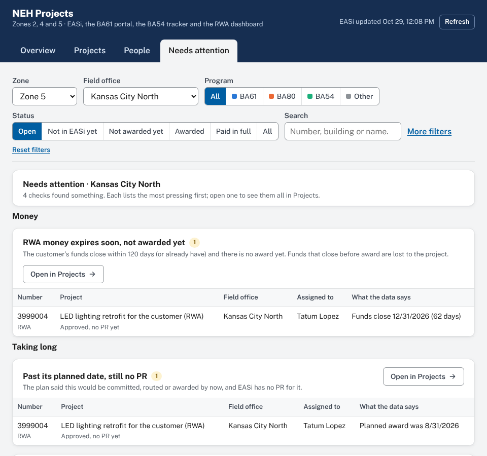

# NEH Projects

NEH Projects (formerly the NEH Project Workload Tracker) is a Google Apps Script web app for seeing everything about the projects in the OFM **Northeast & Heartland (NEH) enterprise** in one place: Zones 2, 4 and 5, seven service centers, 36 field offices. It puts what is planned (the BA61 portal, the BA54 tracker, RWAs and work requests) next to what EASi shows, from draft PR to paid in full, and who is carrying each project, so workload stays one of its main views. It covers the same area as the NEH BA61 Project Portal, the "Northeast Heartland" enterprise in the OFM Building Assignments sheet. It reads five Google Sheets and never changes them:

- the APS Workload Tracker **BA61 Pipeline** report (every purchase request in EASi, refreshed each morning),
- the **OFM Building Assignments** sheet (which zone, service center and field office each building belongs to, and its Field Office Manager),
- the **NEH BA61 Project Portal**'s data sheet, for BA61 projects that are planned or approved there but have no PR in EASi yet, and
- the **BA54 National Tracker** (its Current Program tab), for BA54 projects in the current program that have no PR in EASi yet, and
- the **All Open RWAs and WRs Dashboard** (its Detailed Data tab), for RWAs and RETA work requests: the ones with no PR yet, and the customer and authorized amount behind the PRs that have one.

> **Setting it up?** Follow [docs/DEPLOYMENT.md](docs/DEPLOYMENT.md). It takes about 15 minutes in the browser, with nothing to install.


## What it shows

Four tabs, all following the same filters.

**Overview**
- **Headline numbers** for whatever is filtered: open projects, not in EASi yet (with the estimated amount), not awarded yet (committed), awarded (left to spend), obligated, and how many people are assigned.
- **Needs attention**: a summary of the checks below, each with its count; click one to see its projects.
- **Who has the most projects**: the busiest people, split into not in EASi yet / not awarded yet / awarded, against the average. Switch between everyone, building managers and project managers.
- **Where projects are**: the whole life cycle in three phases, each scaled on its own and with the money that matters there: planned with no PR (estimated), in EASi before award (committed), awarded and paid (obligated, left to spend). Click a step to list its projects.
- **By program**: BA61, BA80 (RWAs) and BA54 side by side, plus Other.
- **Field offices**: one sortable row per office (or, on one office, every office in its zone): manager, projects by phase, left to spend, people, projects each and the busiest person.

**Projects**: every project in a sortable table: EASi PRs, and planned projects from the BA61 portal, the BA54 tracker and the RWA dashboard that have no PR yet. Click a header to sort; Shift-click adds a second sort; ties go largest first. The status shows how long the project has been in that step. Group by field office, person, building or project manager, org code, status, program, building, fiscal year, or **plan vs. EASi**. Click a row (or Tab to it and press Enter) for its panel: what EASi says, the plan behind it (BA61 portal project, BA54 row or RWA with its customer) next to what EASi has committed, a **timeline** from plan to now, location and people. **Download for Excel** saves the list with every field.

**People**: everyone ranked by how many projects they have, counted by person assigned (default), the building's building manager, contracting officer or contract specialist; with not in EASi / not awarded / awarded, BA61/80/54 counts, dollars and their oldest open fiscal year. Split by field office if you like. Click a person to see their projects.

**Needs attention**: checks over the data, grouped as *Money* (RWA funds closing within 120 days with no award; committed more than 25% over the plan; awarded over a year ago with nothing paid), *Taking long* (past the plan's own commitment, PR routing or award date with no PR; approved 60+ days ago with no PR; 60+ days as a draft PR or 30+ days in review or waiting for a contract specialist) and *Fix in the source* (cancelled or denied in the portal but has a PR; nobody assigned; a person named with no email found; a BA54 row with no PCN; a PR with no building in EASi). Each says why it matters, lists the most pressing first, and opens all of them in Projects.



**Words used on the page**: *Not in EASi yet* (planned or approved, no PR yet), *Not awarded yet* (draft PR through contract being written), *Awarded* (money still to be spent), *Paid in full* (all obligated money spent), *Left to spend* (obligated minus spent in Pegasys), *Assigned to* (the COR, or the submitter until there is one; for a plan, its COR, project manager or GSA PM).

**Filters** (shared by every tab, and kept in the page link so you can share a view): zone, field office, program (BA61 / BA80 / BA54 / Other), status (open, not in EASi yet, not awarded yet, awarded, paid in full, all) and a search box that matches PR, RWA, PCN and portal numbers, titles, buildings, people, vendors and customers. Under More filters: service center, fiscal year, service contracts, and planned projects not in EASi yet.

**Who sees what**: anyone at GSA with the link can see all of NEH, but each person opens on their own part of it, as in the NEH BA61 Project Portal: a Field Office Manager on the office they manage and a Service Center Director on their service center (both from the OFM Building Assignments sheet); everyone else on the office in their GSA profile's org code ("Robert Sells - **PMCGC**" → Denver Federal Center; a service-center code like PMCG → Rocky Mountain), or, without one, the office where they lead the most projects. A banner says why, and one click shows all of NEH. A **Zone** filter narrows to Zone 2, 4 or 5; when you look at one office, the comparison table lists the other offices in its zone. Anyone listed on PRs gets a **My projects** link.

## How the numbers work

| Term | Meaning |
|---|---|
| Not in EASi yet | A project that is planned or approved but that no PR in EASi carries yet, from two sheets. **BA61 portal:** Planning, Pending Approval, Approved or Emergency NTP projects, when no PR has the portal number (RM0024-092426) in its title or comments and the EQ number is not a PR in the report (the portal's own EASi sync rule). **BA54 tracker:** Active and Pending projects in the Current Program tab, when no PR from the project's planned fiscal year or the year before lists its PCN or ASID among its project codes (codes are reused for later phases, so an old PR on the same code doesn't count); change orders are left out, since they are money on an award that already exists. **RWA dashboard** (RWAs are BA80): RWAs and work requests on NEH buildings that no PR lists, in FE_RWA_List or written in its title or comments ("RWA #N3858013"), and that have nothing committed or obligated (one with money but no PR is funded another way, such as a lease or a purchase card, and is only counted); work requests being estimated are planning, ones awaiting signature are waiting for approval, accepted RWAs are approved with no PR yet; substantially completed ones are left out, and severable RWAs count as service contracts. A project leaves this group, and shows its EASi status instead, the morning its PR appears. Each one counts as one open project at its building's field office, for its COR (BA61: the portal's COR, or the requester until there is one; BA54: the tracker's project manager, or the one marked "(COR)" when two are named; RWA: the GSA PM in RETA, else in Kahua). Its money is an estimate (the portal's budgeted amount, the tracker's total cost, the RWA's authorized amount), shown as "estimated" and never added to EASi's committed, obligated or left-to-spend totals. Both sheets give people as names; the tracker matches a name to the person's email when exactly one person on the PRs or in the building directory fits it (full name, a common nickname such as Bobby for Robert, or first initial and last name), and otherwise shows the name as written. A cell naming two people ("A / B", "A & B") counts both, and notes like "(design)" or "- PMAC" are ignored. Names it can't work out (a name change, say) go in the `NAME_EMAILS` Script property. Untick **Include planned projects not in EASi yet** under More filters to count only what is in EASi. |
| Plan vs. EASi | A PR that carries a BA61 portal project, a BA54 tracker project or an RWA (with its customer agency) shows it under **Planned as** in its detail panel, with the planned amount next to what EASi has committed, and the Projects table shows "plan $45K" under the committed amount (highlighted when it is more than 25% over or under). **Group by › Plan vs. EASi** sorts every project into: planned and not in EASi yet; within 25% of the plan; more than 25% over or under; a plan but nothing committed yet; also funded from other programs (a BA54 plan on a PR that is also BA80, say, so the amounts aren't comparable); a plan spread over several PRs (one RWA funding three PRs, say); a plan with no amount; no plan on file. A BA54 plan only attaches to PRs from its planned fiscal year or the year before. |
| Days in this stage | None of the sources keep a history, so the tracker records each project's stage at every refresh, in a History tab of its saved-snapshot sheet. When a project is first seen it takes a real date if its source has one (the award date, the portal's decision or submission date, the RWA's acceptance or work request date); otherwise "40+ days" means it has been there at least since the tracker began recording. A change seen between two refreshes is dated that day. The project panel's timeline puts the plan's stages before the PR's own. |
| Needs attention | Each check uses only the data on the page and follows the filters (not the status buttons: each check picks the stages it is about). The thresholds are in `webapp/JsAttention.html`. |
| Names | People are shown as the GSA directory names them ("Robert J. Green"), from the same weekly directory sweep that finds org codes; until a sweep has run, the name comes from the email. |
| Where this comes from | The bottom of every view lists each source sheet with a link, what it adds, and how fresh it is: when EASi generated its report, the directory's "Last Updated" date, the portal's latest project change, the BA54 tracker's "Obligation Data As of" date, and the RWA dashboard's "Data as of" date. |
| NEH PR | A PR with at least one NEH building in `FE_Building_Code_List`. When EASi lists no building, building numbers in the PR title are used. A PR with only an NEH OFM org code (P00MCA00 … P00MCG00) is shown at service-center level. PRs with no building at all (national contracts, broker leases) are left out. |
| Service contracts | Hidden by default (the **Type** filter brings them back), because they aren't projects. A PR is a service contract when its EASi procurement category is a 5- or 10-year service IDV/BPA, utilities, ESPC or a lease order, or, for Services/Other PRs, when its title reads like a recurring service: custodial or janitorial services, snow removal, groundskeeping, full maintenance, O&M or FE services, CFM, elevator maintenance, option years. A title that names building work (replace, repair, install, renovate, construction, CM) stays a project, so "Janitor closet … leaking" and "Multi-Project O&M R&A" count. The project's detail panel says why a PR was classed as a service contract. The rules are in `webapp/Config.gs`. |
| Multi-project PRs | One award that funds several projects is one PR in EASi. PRs listed in `SUB_PROJECTS` in `webapp/Config.gs` count as their number of projects everywhere (totals, pipeline, programs, offices, each person's workload); the table shows "8 projects" and the detail panel lists them. EQPMBA-26-0272 (Building 56 and 67 Multi-Project O&M R&A) is listed with its 8 DWP26104 projects. |
| Field office | From the building. A PR on buildings in two offices appears under both. |
| Program | `FE_Program_Code_List`: PG61 = BA61, PG80 = BA80, PG54 = BA54, anything else = Other. A draft PR often has no code yet; then "BA61", "BA 80", "PG54" in the title, or a BA61 portal number (RM0028-092426), sets it. A PR funded from two programs counts in both. |
| EASi status | From Acquisition Status, Award Status and PR Status. **Awarded · open** has money obligated and not all of it expended in Pegasys; **Fully expended** has it all expended (or nothing obligated). **Open** = everything except fully expended. |
| Person assigned | The COR on the PR, or the submitter (EASi's requestor) until a COR is named; pre-award PRs rarely have a COR yet, and on 82% of PRs with both they are the same person. This is the default for "who has the most projects". |
| Committed / Obligated / Expended / Unexpended | `PR_Committed_Amount`, `Award_Obligated_Amount`, `Variance_Pegasys_Expended_Amount`, and obligated − expended. |
| Building or project manager | Building managers are the people ServiceNow lists as a building's contact (primary or secondary) in the OFM Building Assignments sheet; everyone else assigned to projects is a project manager. Org codes are shown, but they don't decide the role: project management groups under property management have PM… codes too. To correct individual people, list their emails in the `BUILDING_MANAGER_EMAILS` or `PROJECT_MANAGER_EMAILS` Script property. The **Show: Everyone / Building managers / Project managers** switch (on the people chart and the People tab) filters the whole page to projects that group is assigned; a PR with one person in each group counts for both. Org codes come from one sweep of the GSA directory, repeated weekly (or after 12 hours when new people appear) and kept in Script properties. |
| Division | The People tab's **Role** column shows each person's org code; click it to sort people by team and division. Projects can be grouped by **Building or project manager** or **Org code**. |
| Building manager | The ServiceNow primary POC for the PR's buildings, from the OFM Building Assignments sheet. |

On the October 29, 2026 report, 3,609 of the 10,294 PRs nationwide are on NEH buildings: 1,480 in Zone 2, 1,286 in Zone 4, 874 in Zone 5 (a PR can touch two zones). 480 are service contracts. Of the projects, 2,373 are open: 925 in Zone 2, 879 in Zone 4, 589 in Zone 5.

## How it works

The server reads the sheets, keeps only NEH, and stores the result gzipped (about 0.7 MB instead of 5 MB) in the script cache and in a saved copy (a small Google Sheet the tracker creates in the owner's Drive, "NEH Project Workload Tracker - saved snapshot"), so that if Google empties the cache early the next page load reads the copy in a second or two instead of rebuilding. The data is sent inside the page itself, so opening the tracker is a single request. So a page load doesn't re-read 10,000 rows. It rebuilds every 4 hours and at 7:30 Central each morning (after EASi regenerates the report), and anyone can press **Refresh** (once every 10 minutes; admins any time). The web app runs as the person who deployed it, so viewers don't need access to the source sheets, and only people signed in with a GSA account can open it.

| File | What it does |
|---|---|
| `webapp/Config.gs` | Sheet IDs, zone, programs, stages, roles. Any setting can be overridden in Script properties. |
| `webapp/Pipeline.gs` | Turns the sheets into the NEH dataset (pure functions, tested in Node). |
| `webapp/History.gs` | The stage history: when each project reached its stage, kept across refreshes (pure functions, tested in Node). |
| `webapp/Planned.gs`, `Portal.gs`, `Ba54.gs`, `Rwa.gs` | Add the BA61 portal, BA54 tracker and RWA dashboard projects that have no PR in EASi yet, and match the names in them to emails (pure functions, tested in Node). |
| `webapp/Data.gs` | Reads the sheets, caches the snapshot, works out who is signed in. |
| `webapp/Directory.gs` | Reads the signed-in person's org code from the GSA directory (People API) to pick their starting office; `checkDirectoryLookup()` tests it. |
| `webapp/Api.gs` | The two functions the page calls: `apiLoad`, `apiRefresh`. |
| `webapp/Setup.gs` | `setup()` (run once) and the scheduled refresh. |
| `webapp/Web.gs` | `doGet`, link parameters. |
| `webapp/Index.html`, `Styles.html`, `JsCore.html`, `JsApp.html`, `JsAttention.html` | The page: a dependency-free single-page app. All data is inserted as text, never as HTML. |
| `dev/` | Apps Script mock, tests, local preview, browser checks. |
| `tools/export_sheets.py` | Converts downloaded copies of the sheets to JSON for local testing. |

### Settings (Apps Script › Project Settings › Script properties)

| Property | Default |
|---|---|
| `PIPELINE_ID` | `1Z0CNVnAft_h4dwJeket99PDwobLMC7YS2zUN55zNlAU` (WLT - BA61 Pipeline) |
| `PIPELINE_TAB` | `Pipeline` |
| `DIRECTORY_ID` | `1jH7ffxNrT2rFl2P0p-SFFH9z_yYcsH4W2qnBMB_xuAw` (OFM Building Assignments) |
| `DIRECTORY_TAB` / `ORG_TAB` | `Buildings` / `Org Relationships` |
| `PORTAL_ID` / `PORTAL_TAB` | `1Vi0986jvcQ-45VQFY0JnGHSgimrQCc8DtpFIegUqG9Y` (NEH BA61 Portal – Data) / `Projects`; `OFF` leaves portal projects out |
| `PORTAL_URL` | the portal's web app (`…/exec`), for links to each portal project |
| `BA54_ID` / `BA54_TAB` | `1yymDTl2sHxfFvh6oYIiiO6-J1e0w1z9aO4nxsaprHj8` (BA54 National Tracker) / `Current Program`; `OFF` leaves BA54 tracker projects out |
| `RWA_ID` / `RWA_TAB` | `1x-_djqh6dugexhMHUHUEqnl5KnuwtH1r---AGgY4eu0` (All Open RWAs and WRs Dashboard) / `Detailed Data`; `OFF` leaves RWAs out |
| `NAME_EMAILS` | blank; names in the BA61 portal or BA54 tracker the tracker can't match on its own, as `Name = email; Name = email` (for example someone whose name changed but whose email didn't) |
| `ENTERPRISE` / `ENTERPRISE_SHORT` | `Northeast Heartland` / `NEH` (any enterprise in the sheet works) |
| `ZONE` | blank = the whole enterprise; `5` = only Zone 5 |
| `BUILDING_MANAGER_EMAILS` / `PROJECT_MANAGER_EMAILS` | blank; comma-separated emails that correct the building manager / project manager split for individual people |
| `ADMIN_EMAILS` | blank (the deployer is always an admin) |
| `CACHE_MINUTES` | `360` |

## Developing locally

Requires Node 18+. Playwright is only needed for the browser checks.

```bash
npm test                 # backend tests on made-up data
npm run preview          # http://localhost:8080 with made-up data; add ?as=sam.foothills@gsa.gov to be the demo Denver FC manager
```

To test with the real sheets, download them as .xlsx (File › Download › Microsoft Excel), then:

```bash
python3 tools/export_sheets.py "WLT - BA61 Pipeline.xlsx" "OFM Building Assignments.xlsx" /tmp/sources.json "NEH BA61 Portal - Data.xlsx" "BA54 National Tracker.xlsx" "All Open RWAs and WRs Dashboard.xlsx"
SOURCES_JSON=/tmp/sources.json npm test
node dev/server.js --sources /tmp/sources.json
node dev/flow.js http://localhost:8080          # clicks through filters, sorting, grouping, drill-downs, export
node dev/screenshots.js out/ http://localhost:8080
```

The exported JSON holds real data; `.gitignore` keeps `*.json` and `*.xlsx` out of the repository.
