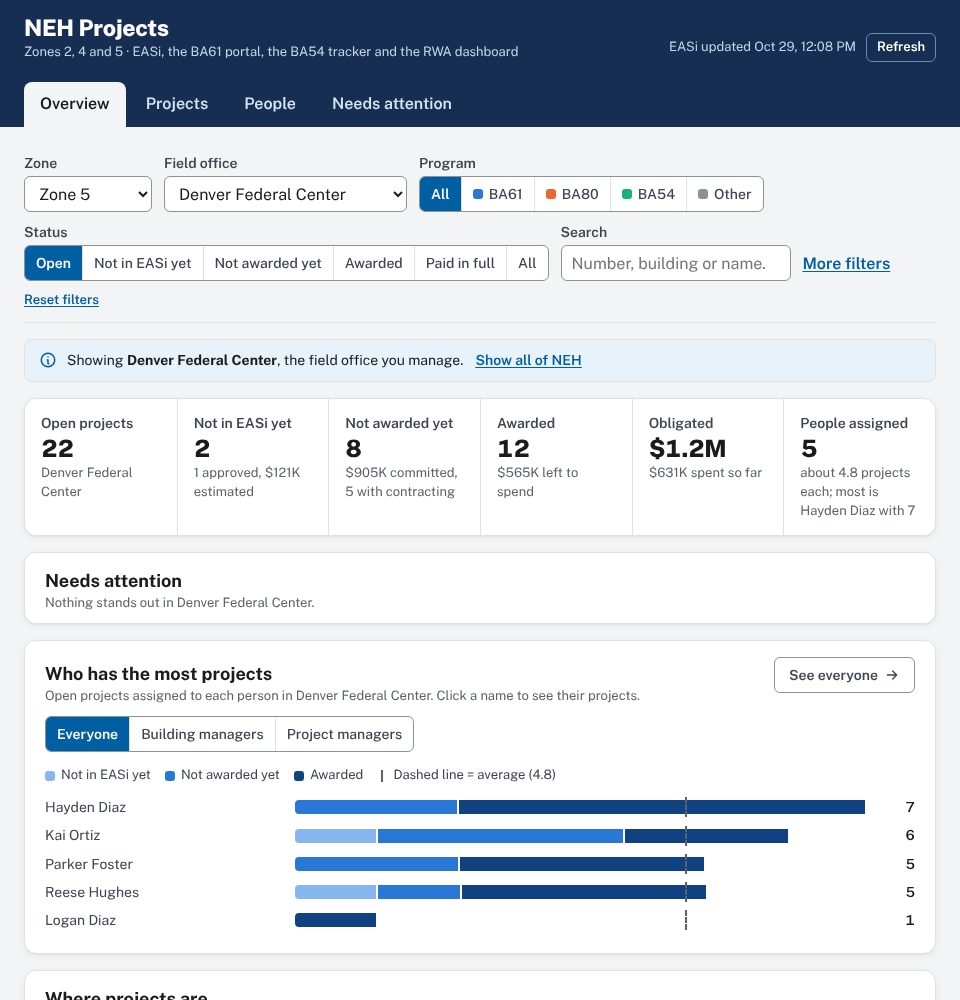

# NEH Project Workload Tracker

A Google Apps Script web app that shows the EASi status of every project in the OFM **Northeast & Heartland (NEH) enterprise**: Zones 2, 4 and 5, seven service centers, 36 field offices. It also shows who is carrying them. It covers the same area as the NEH BA61 Project Portal, the "Northeast Heartland" enterprise in the OFM Building Assignments sheet. It reads three Google Sheets and never changes them:

- the APS Workload Tracker **BA61 Pipeline** report (every purchase request in EASi, refreshed each morning),
- the **OFM Building Assignments** sheet (which zone, service center and field office each building belongs to, and its Field Office Manager), and
- the **NEH BA61 Project Portal**'s data sheet, for BA61 projects that are planned or approved there but have no PR in EASi yet.

> **Setting it up?** Follow [docs/DEPLOYMENT.md](docs/DEPLOYMENT.md). It takes about 15 minutes in the browser, with nothing to install.



## What it shows

**Overview**
- Headline numbers for whatever is filtered: projects, pre-award, awarded and open, committed, obligated, unexpended, and how many project leads.
- **Where projects are in EASi**: PRs by stage (draft → review → awaiting assignment → with contracting → solicitation → award drafting → awarded → fully expended). Click a stage to list those PRs.
- **By program**: BA61, BA80 and BA54 side by side (plus Other).
- **Field offices**: one sortable row per office with its manager, project counts by stage and program, dollars, number of project leads, projects per lead, and the person with the most.
- **Who has the most projects**: the busiest project leads, split pre-award / awarded / expended.

**Projects**: every PR in a sortable table (click a header; click again to reverse; Shift-click to add a second sort). Group by field office, person assigned, building or project manager, org code, status, program, building or fiscal year. Click a row for the full EASi record and a link into EASi. **Download for Excel** saves what you see.

**People**: everyone ranked by how many projects they have, counted by person assigned (default), the building's building manager, contracting officer or contract specialist, with not awarded yet vs awarded, BA61/80/54 counts, dollars and their oldest open fiscal year. Split by field office if you like. Click a person to see their projects. Export to CSV.

**Words used on the page**: *Not awarded yet* (draft PR through contract being written), *Awarded* (money still to be spent), *Paid in full* (all obligated money spent), *Left to spend* (obligated minus spent in Pegasys), *Assigned to* (the COR, or the submitter until there is one).

**Filters** (shared by all three views, and kept in the page link so you can share a view): service center, field office, program (BA61 / BA80 / BA54 / Other), EASi status (open, pre-award, awarded, fully expended, all), PR fiscal year, type (projects only, or with service contracts), and a search box that matches PR numbers, titles, buildings, people, vendors, RWA and BA61 portal numbers.

**Who sees what**: anyone at GSA with the link can see all of NEH, but each person opens on their own part of it, as in the NEH BA61 Project Portal: a Field Office Manager on the office they manage and a Service Center Director on their service center (both from the OFM Building Assignments sheet); everyone else on the office in their GSA profile's org code ("Robert Sells - **PMCGC**" → Denver Federal Center; a service-center code like PMCG → Rocky Mountain), or, without one, the office where they lead the most projects. A banner says why, and one click shows all of NEH. A **Zone** filter narrows to Zone 2, 4 or 5; when you look at one office, the comparison table lists the other offices in its zone. Anyone listed on PRs gets a **My projects** link.

## How the numbers work

| Term | Meaning |
|---|---|
| Not in EASi yet | A BA61 Project Portal project that is Planning, Pending Approval, Approved or Emergency NTP, and that no PR in EASi carries yet: no PR has its portal number (RM0024-092426) in its title or comments, and its EQ number is not a PR in the report. That is the same rule the portal's own EASi sync uses, so a project leaves this group, and shows its EASi status instead, the morning its PR appears. Each one counts as one open project for its COR (or its requester until a COR is named) at its building's field office. Its money is the portal's **budgeted amount**, an estimate, shown as "budgeted" and never added to EASi's committed, obligated or left-to-spend totals. The portal gives CORs as names; the tracker matches a name to the person's email when exactly one person on the PRs or in the building directory fits it (full name, a common nickname such as Bobby for Robert, or first initial and last name), and otherwise shows the name as written. Names it can't work out (a name change, say) go in the `PORTAL_COR_EMAILS` Script property. Untick **Include BA61 portal projects not in EASi yet** under More filters to count only what is in EASi. |
| NEH PR | A PR with at least one NEH building in `FE_Building_Code_List`. When EASi lists no building, building numbers in the PR title are used. A PR with only an NEH OFM org code (P00MCA00 … P00MCG00) is shown at service-center level. PRs with no building at all (national contracts, broker leases) are left out. |
| Service contracts | Hidden by default (the **Type** filter brings them back), because they aren't projects. A PR is a service contract when its EASi procurement category is a 5- or 10-year service IDV/BPA, utilities, ESPC or a lease order, or, for Services/Other PRs, when its title reads like a recurring service: custodial or janitorial services, snow removal, groundskeeping, full maintenance, O&M or FE services, CFM, elevator maintenance, option years. A title that names building work (replace, repair, install, renovate, construction, CM) stays a project, so "Janitor closet … leaking" and "Multi-Project O&M R&A" count. The project's detail panel says why a PR was classed as a service contract. The rules are in `webapp/Config.gs`. |
| Multi-project PRs | One award that funds several projects is one PR in EASi. PRs listed in `SUB_PROJECTS` in `webapp/Config.gs` count as their number of projects everywhere (totals, pipeline, programs, offices, each person's workload); the table shows "8 projects" and the detail panel lists them. EQPMBA-26-0272 (Building 56 and 67 Multi-Project O&M R&A) is listed with its 8 DWP26104 projects. |
| Field office | From the building. A PR on buildings in two offices appears under both. |
| Program | `FE_Program_Code_List`: PG61 = BA61, PG80 = BA80, PG54 = BA54, anything else = Other. A draft PR often has no code yet; then "BA61", "BA 80", "PG54" in the title, or a BA61 portal number (RM0028-092426), sets it. A PR funded from two programs counts in both. |
| EASi status | From Acquisition Status, Award Status and PR Status. **Awarded · open** has money obligated and not all of it expended in Pegasys; **Fully expended** has it all expended (or nothing obligated). **Open** = everything except fully expended. |
| Person assigned | The COR on the PR, or the submitter (EASi's requestor) until a COR is named; pre-award PRs rarely have a COR yet, and on 82% of PRs with both they are the same person. This is the default for "who has the most projects". |
| Committed / Obligated / Expended / Unexpended | `PR_Committed_Amount`, `Award_Obligated_Amount`, `Variance_Pegasys_Expended_Amount`, and obligated − expended. |
| Building or project manager | Building managers are the people ServiceNow lists as a building's contact (primary or secondary) in the OFM Building Assignments sheet; everyone else assigned to projects is a project manager. Org codes are shown, but they don't decide the role: project management groups under property management have PM… codes too. To correct individual people, list their emails in the `BUILDING_MANAGER_EMAILS` or `PROJECT_MANAGER_EMAILS` Script property. The **Show: Everyone / Building managers / Project managers** switch (on the people chart and the People tab) filters the whole page to projects that group is assigned; a PR with one person in each group counts for both. Org codes come from one sweep of the GSA directory, repeated weekly (or after 12 hours when new people appear) and kept in Script properties. |
| Division | The People tab's **Role** column shows each person's org code; click it to sort people by team and division. Projects can be grouped by **Building or project manager** or **Org code**. |
| Building manager | The ServiceNow primary POC for the PR's buildings, from the OFM Building Assignments sheet. |

On the October 29, 2026 report, 3,609 of the 10,294 PRs nationwide are on NEH buildings: 1,480 in Zone 2, 1,286 in Zone 4, 874 in Zone 5 (a PR can touch two zones). 480 are service contracts. Of the projects, 2,373 are open: 925 in Zone 2, 879 in Zone 4, 589 in Zone 5.

## How it works

The server reads the sheets, keeps only NEH, and stores the result gzipped (about 0.7 MB instead of 5 MB) in the script cache and in a saved copy (a small Google Sheet the tracker creates in the owner's Drive, "NEH Project Workload Tracker - saved snapshot"), so that if Google empties the cache early the next page load reads the copy in a second or two instead of rebuilding. The data is sent inside the page itself, so opening the tracker is a single request. So a page load doesn't re-read 10,000 rows. It rebuilds every 4 hours and at 7:30 Central each morning (after EASi regenerates the report), and anyone can press **Refresh** (once every 10 minutes; admins any time). The web app runs as the person who deployed it, so viewers don't need access to the source sheets, and only people signed in with a GSA account can open it.

| File | What it does |
|---|---|
| `webapp/Config.gs` | Sheet IDs, zone, programs, stages, roles. Any setting can be overridden in Script properties. |
| `webapp/Pipeline.gs` | Turns the sheets into the NEH dataset (pure functions, tested in Node). |
| `webapp/Portal.gs` | Adds the BA61 portal projects that have no PR in EASi yet (pure functions, tested in Node). |
| `webapp/Data.gs` | Reads the sheets, caches the snapshot, works out who is signed in. |
| `webapp/Directory.gs` | Reads the signed-in person's org code from the GSA directory (People API) to pick their starting office; `checkDirectoryLookup()` tests it. |
| `webapp/Api.gs` | The two functions the page calls: `apiLoad`, `apiRefresh`. |
| `webapp/Setup.gs` | `setup()` (run once) and the scheduled refresh. |
| `webapp/Web.gs` | `doGet`, link parameters. |
| `webapp/Index.html`, `Styles.html`, `JsCore.html`, `JsApp.html` | The page: a dependency-free single-page app. All data is inserted as text, never as HTML. |
| `dev/` | Apps Script mock, tests, local preview, browser checks. |
| `tools/export_sheets.py` | Converts downloaded copies of the sheets to JSON for local testing. |

### Settings (Apps Script › Project Settings › Script properties)

| Property | Default |
|---|---|
| `PIPELINE_ID` | `1Z0CNVnAft_h4dwJeket99PDwobLMC7YS2zUN55zNlAU` (WLT - BA61 Pipeline) |
| `PIPELINE_TAB` | `Pipeline` |
| `DIRECTORY_ID` | `1jH7ffxNrT2rFl2P0p-SFFH9z_yYcsH4W2qnBMB_xuAw` (OFM Building Assignments) |
| `DIRECTORY_TAB` / `ORG_TAB` | `Buildings` / `Org Relationships` |
| `PORTAL_ID` / `PORTAL_TAB` | `1Vi0986jvcQ-45VQFY0JnGHSgimrQCc8DtpFIegUqG9Y` (NEH BA61 Portal – Data) / `Projects`; `OFF` leaves portal projects out |
| `PORTAL_URL` | the portal's web app (`…/exec`), for links to each portal project |
| `PORTAL_COR_EMAILS` | blank; portal COR names the tracker can't match on its own, as `Name = email; Name = email` (for example someone whose name changed but whose email didn't) |
| `ENTERPRISE` / `ENTERPRISE_SHORT` | `Northeast Heartland` / `NEH` (any enterprise in the sheet works) |
| `ZONE` | blank = the whole enterprise; `5` = only Zone 5 |
| `BUILDING_MANAGER_EMAILS` / `PROJECT_MANAGER_EMAILS` | blank; comma-separated emails that correct the building manager / project manager split for individual people |
| `ADMIN_EMAILS` | blank (the deployer is always an admin) |
| `CACHE_MINUTES` | `360` |

## Developing locally

Requires Node 18+. Playwright is only needed for the browser checks.

```bash
npm test                 # backend tests on made-up data
npm run preview          # http://localhost:8080 with made-up data; add ?as=sam.foothills@gsa.gov to be the demo Denver FC manager
```

To test with the real sheets, download them as .xlsx (File › Download › Microsoft Excel), then:

```bash
python3 tools/export_sheets.py "WLT - BA61 Pipeline.xlsx" "OFM Building Assignments.xlsx" /tmp/sources.json "NEH BA61 Portal - Data.xlsx"
SOURCES_JSON=/tmp/sources.json npm test
node dev/server.js --sources /tmp/sources.json
node dev/flow.js http://localhost:8080          # clicks through filters, sorting, grouping, drill-downs, export
node dev/screenshots.js out/ http://localhost:8080
```

The exported JSON holds real data; `.gitignore` keeps `*.json` and `*.xlsx` out of the repository.
